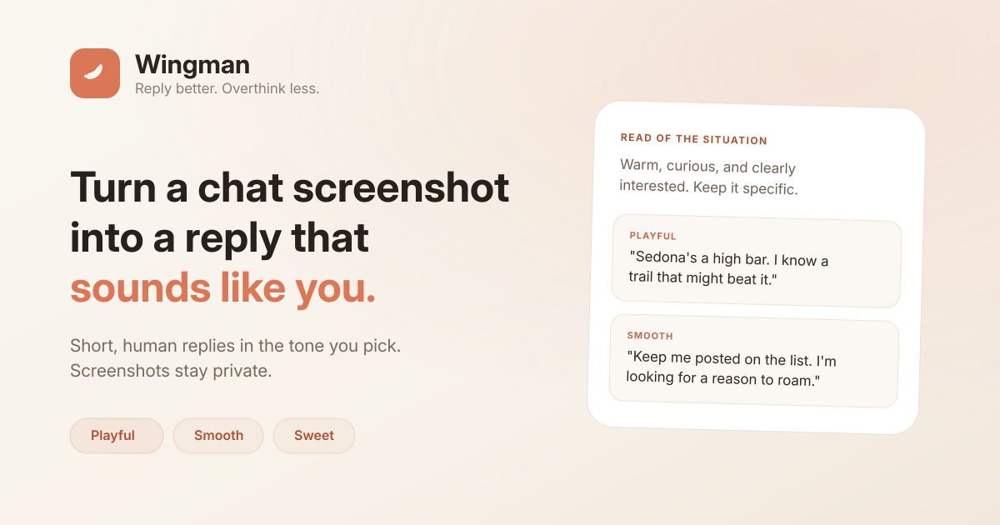

<p align="center">
  
</p>

<h1 align="center">Wingman</h1>

You know that moment when someone sends you a message and you stare at it for ten minutes because you have no idea what to say back? Wingman is for that.

Upload a screenshot of the chat, pick a tone and what you're trying to get out of the conversation, and it gives you three reply options. You pick one, tweak it, send it. That's the whole thing.

I built it because I wanted something that sounds like a person wrote it, not a corporate chatbot. Whether it actually pulls that off depends a lot on which model you plug in.

<p align="center">
  
</p>

## What it does

- Reads a chat screenshot and writes replies that fit the conversation
- Tones: playful, smooth, funny, confident, sweet, direct
- Goals: keep the chat going, get a number, ask for a date, revive a dead conversation, or politely say no
- Also has a pickup line generator if you just need an opener (you describe the vibe, it gives you lines)

It works with any OpenAI-compatible API as long as the model can look at images.

## Deploy it

The quickest way is Vercel. Click the button, and it'll ask you for the three required env variables during setup.

[](https://vercel.com/new/clone?repository-url=https%3A%2F%2Fgithub.com%2Ffakeheckeross%2Fwingman&env=AI_BASE_URL,AI_API_KEY,AI_MODEL&envDescription=Any%20OpenAI-compatible%20endpoint%20with%20a%20vision%20model&project-name=wingman)

## Running it locally

You need Node 18+ or Bun, plus an API endpoint with a vision model.

```bash
git clone https://github.com/fakeheckeross/wingman.git
cd wingman
bun install
cp .env.example .env.local
```

Open `.env.local` and fill in:

| Variable | Required | What it's for |
|----------|----------|---------------|
| `AI_BASE_URL` | yes | Your provider's base URL. Include the `/v1` part. |
| `AI_API_KEY` | yes | Your API key |
| `AI_MODEL` | yes | The exact model name your provider expects. It has to support image input. |
| `NEXT_PUBLIC_SITE_URL` | no | Your site's full URL, used for SEO and OG tags |

Then start it:

```bash
bun dev
```

It'll be at http://localhost:3000.

For production:

```bash
bun run build
bun start
```

## Picking a provider

Anything that speaks the OpenAI chat completions format and has a vision model will work. I've used or would expect these to be fine:

- **OpenRouter**, which has a ton of vision models (Qwen VL, Llama Vision, etc.)
- **OpenAI**, e.g. `gpt-4o` or `gpt-4o-mini`
- **Together.ai**, for Llama 3.2 Vision

If you're using something else, just set `AI_BASE_URL` and `AI_MODEL` to match what that provider documents. Double check the model really accepts images, because some that look like they should, don't.

If you want to change how the replies sound, `lib/prompt.ts` is where to look. Most of the personality lives there.

## Rate limiting

There's a simple per-IP limit so nobody burns through your API credits: 10 requests a minute and 50 an hour. Change the numbers in `lib/server/rate-limit.ts` if that doesn't suit you.